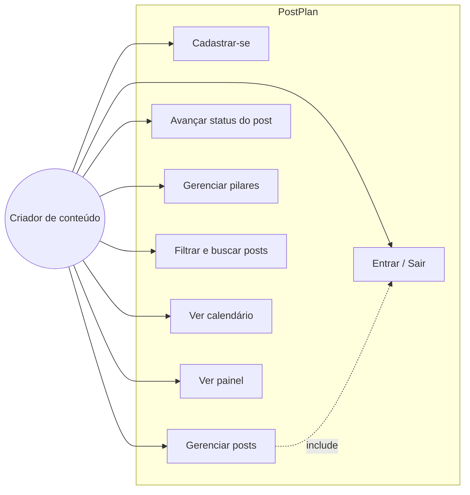
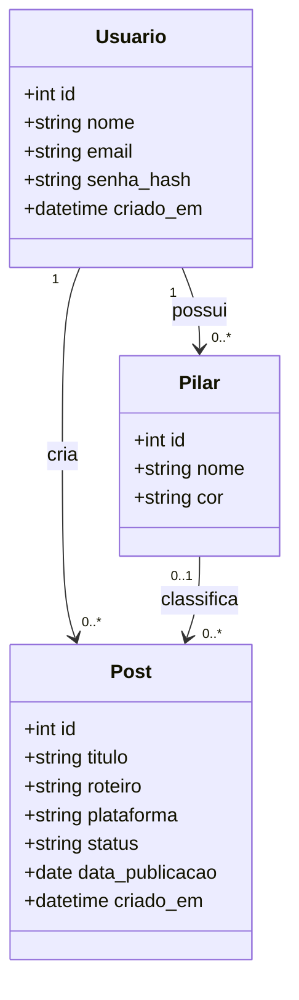
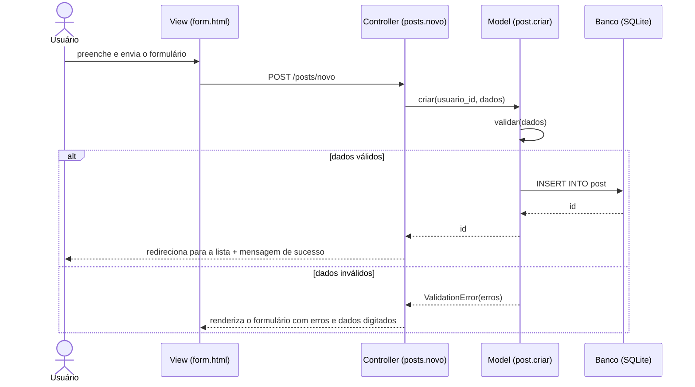
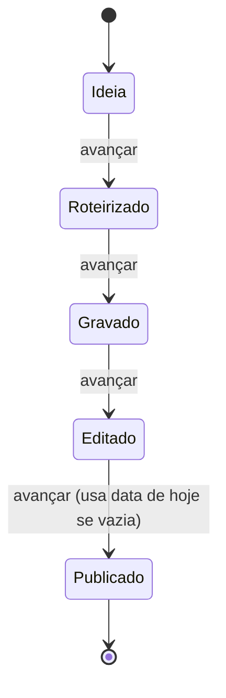

# Situação 1 — Escopo, requisitos e modelagem (revisão do PIT I)

## 1. Escopo revisado (ciclo Kaizen)

**PostPlan** é uma aplicação web para criadores de conteúdo organizarem a produção de posts: da ideia ao
roteiro, gravação, edição e publicação.

**Problema:** criadores iniciantes guardam ideias em notas soltas, perdem datas de publicação e não enxergam
o equilíbrio entre os temas que postam.

**Público-alvo:** criadores de conteúdo individuais (lifestyle, viagens, receitas etc.).

**Dentro do escopo:** cadastro e login; CRUD de posts; pilares de conteúdo (categorias); funil de status;
filtros e busca; calendário de publicações; painel com resumo.

**Fora do escopo (versões futuras):** publicação automática nas redes, métricas de engajamento, trabalho em equipe.

### Melhorias aplicadas na revisão
| Ponto revisado | Antes | Depois |
|---|---|---|
| Banco de dados | Não definido | SQLite com esquema normalizado (3FN), chaves estrangeiras e restrições CHECK |
| Validação | Só no navegador | Validação no servidor (Model) + atributos HTML5 |
| Segurança | — | Senhas com hash, token CSRF, SQL parametrizado, escape automático de HTML |
| Arquitetura | Telas soltas | Padrão MVC (models / controllers / templates) |

## 2. Requisitos

### Funcionais
| ID | Requisito | Prioridade |
|---|---|---|
| RF01 | O usuário deve poder criar conta com nome, e-mail e senha | Alta |
| RF02 | O usuário deve poder entrar e sair do sistema | Alta |
| RF03 | O usuário deve poder criar, editar, listar e excluir posts | Alta |
| RF04 | O post deve ter título, plataforma, status, data de publicação (opcional), roteiro e pilar (opcional) | Alta |
| RF05 | O usuário deve poder avançar o status de um post (ideia → roteirizado → gravado → editado → publicado) | Alta |
| RF06 | O usuário deve poder criar e excluir pilares de conteúdo | Média |
| RF07 | O usuário deve poder filtrar posts por status e pilar e buscar pelo título | Média |
| RF08 | O sistema deve exibir um calendário com os posts agendados | Média |
| RF09 | O painel deve mostrar a quantidade de posts por status e as próximas publicações | Média |

### Não funcionais
| ID | Requisito | Como é atendido |
|---|---|---|
| RNF01 | Usabilidade: interface clara, consistente e com feedback | Mensagens de sucesso/erro, rótulos claros, confirmação ao excluir |
| RNF02 | Segurança: senhas protegidas e dados isolados por usuário | Hash (werkzeug), filtro por `usuario_id` em toda consulta, CSRF |
| RNF03 | Responsividade | CSS com media query; testado em 390 px de largura |
| RNF04 | Acessibilidade | Labels associados, `aria-live` nos avisos, foco visível, link “pular para o conteúdo”, suporte a tema escuro |
| RNF05 | Manutenibilidade | MVC, testes automatizados (41 testes) |

### Regras de negócio
- RN01: e-mail é único no sistema.
- RN02: a senha deve ter no mínimo 8 caracteres.
- RN03: título do post tem de 3 a 120 caracteres; roteiro, até 2000.
- RN04: post com status “publicado” exige data de publicação (ao avançar etapa sem data, usa-se a data de hoje).
- RN05: um usuário nunca acessa posts ou pilares de outro usuário.
- RN06: excluir um pilar não exclui os posts; eles ficam sem pilar.
- RN07: o nome do pilar é único por usuário.

## 3. Casos de uso

**Descrição — UC03 Gerenciar posts**
- Ator: criador de conteúdo autenticado.
- Pré-condição: estar logado.
- Fluxo principal: (1) acessa “Posts”; (2) clica em “Novo post”; (3) preenche o formulário; (4) o sistema valida e salva; (5) exibe mensagem de sucesso e a lista atualizada.
- Fluxo alternativo A1 (dados inválidos): o sistema mantém o que foi digitado, destaca os campos com erro e exibe a mensagem de cada um.
- Fluxo alternativo A2 (excluir): o sistema pede confirmação antes de remover.

## 4. Diagrama de classes (persistência)

## 5. Diagrama de sequência — criar post

## 6. Diagrama de atividades — ciclo de vida do post

