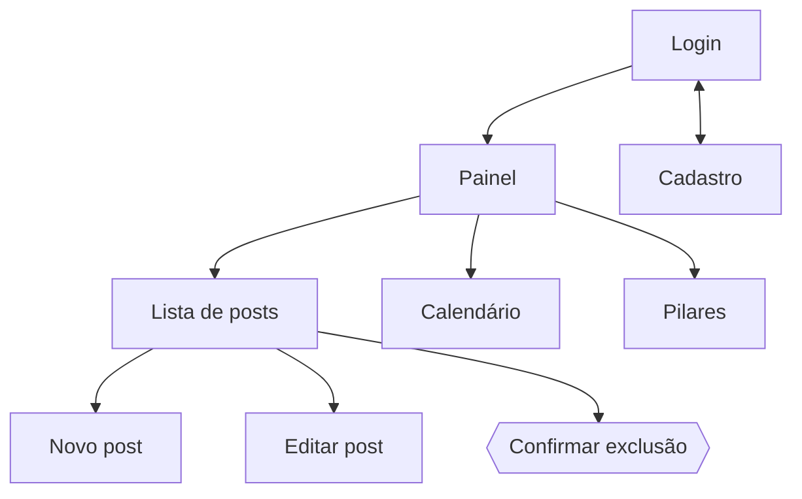

# Situação 1 — IHC (Interface Humano-Computador)

## Mapa de navegação

## Telas
| Tela | Rota | Objetivo |
|---|---|---|
| Login | `/login` | Autenticar |
| Cadastro | `/cadastro` | Criar conta |
| Painel | `/` | Funil por status + próximas publicações |
| Posts | `/posts` | Listar, filtrar, avançar etapa, editar, excluir |
| Novo/Editar post | `/posts/novo`, `/posts/<id>/editar` | Formulário |
| Calendário | `/calendario` | Posts agrupados por data |
| Pilares | `/pilares/` | Criar e excluir categorias |
| Erro | 400 / 404 / 500 | Mensagem amigável com caminho de volta |

## Mensagens (feedback ao usuário)
| Situação | Mensagem |
|---|---|
| Conta criada | “Conta criada! Agora é só entrar.” |
| Login inválido | “E-mail ou senha incorretos.” (não revela qual dos dois errou) |
| Post criado/atualizado/excluído | “Post criado com sucesso!” / “Post atualizado.” / “Post excluído.” |
| Título inválido | “O título deve ter entre 3 e 120 caracteres.” |
| Data inválida | “Data inválida. Use o formato AAAA-MM-DD.” |
| Publicado sem data | “Informe a data de publicação para posts publicados.” |
| E-mail repetido | “Este e-mail já está cadastrado.” |
| Lista vazia | “Nenhum post encontrado…” com link para criar |
| Rota inexistente | “Página não encontrada” + botão “Voltar ao início” |

## Princípios do material teórico aplicados
| Princípio | Onde aparece |
|---|---|
| Clara | Rótulos em português simples; campos obrigatórios identificados |
| Consistente | Mesmo cabeçalho, botões primários roxos, selos de status iguais em todas as telas |
| Simples | Uma tarefa por tela; filtros só com 3 campos |
| Controlada pelo usuário | O sistema só muda status quando o usuário clica em “Avançar etapa” |
| Direta | Cada botão mostra o efeito imediato na lista |
| Recuperável | Confirmação antes de excluir; formulário mantém o que foi digitado após erro |
| Dá resposta | Avisos de sucesso/erro no topo, sempre visíveis |
| Esteticamente agradável | Paleta única, espaçamento generoso, tema escuro automático |

## Acessibilidade
Labels ligados aos campos, `aria-invalid` + `aria-describedby` nos erros, região `aria-live` para avisos, foco visível,
navegação por teclado, link “pular para o conteúdo”, contraste adequado e layout responsivo (tabela vira cartões no celular).
