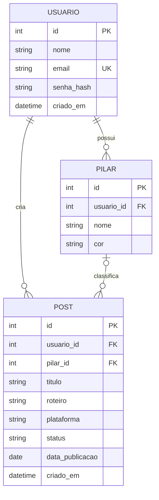

# Situação 1 — Projeto de banco de dados

SGBD: **SQLite 3** (popular, de fácil manutenção; o esquema em `database/schema.sql` usa SQL padrão e migra com poucas mudanças para PostgreSQL ou MySQL).

## Projeto conceitual (DER)


## Projeto lógico (normalizado)
- **1FN:** todos os atributos são atômicos (sem listas dentro de colunas).
- **2FN:** todas as tabelas têm chave primária simples (`id`), então não há dependência parcial.
- **3FN:** nenhum atributo não-chave depende de outro não-chave. O nome e a cor do pilar ficam em `pilar`, não repetidos em `post`.

```
usuario (id PK, nome, email UNIQUE, senha_hash, criado_em)
pilar   (id PK, usuario_id FK→usuario, nome, cor)            UNIQUE(usuario_id, nome)
post    (id PK, usuario_id FK→usuario, pilar_id FK→pilar NULL, titulo, roteiro,
         plataforma, status, data_publicacao NULL, criado_em)
```

## Projeto físico
Script completo: [`database/schema.sql`](../../database/schema.sql).

Decisões: `ON DELETE CASCADE` de usuário para pilar e post; `ON DELETE SET NULL` de pilar para post (RN06);
índices em `post(usuario_id, status)` e `post(usuario_id, data_publicacao)` para as consultas do painel, lista e calendário;
`CHECK` para domínios (plataforma, status, tamanhos, formato da cor).

## Dicionário de dados

### usuario
| Coluna | Tipo | Nulo | Chave | Domínio / regra |
|---|---|---|---|---|
| id | INTEGER | não | PK | autoincremento |
| nome | TEXT | não | | 2 a 80 caracteres |
| email | TEXT | não | UNIQUE | formato de e-mail, salvo em minúsculas |
| senha_hash | TEXT | não | | hash PBKDF2/scrypt (nunca a senha) |
| criado_em | TEXT | não | | data/hora UTC, padrão `datetime('now')` |

### pilar
| Coluna | Tipo | Nulo | Chave | Domínio / regra |
|---|---|---|---|---|
| id | INTEGER | não | PK | autoincremento |
| usuario_id | INTEGER | não | FK → usuario.id | dono do pilar |
| nome | TEXT | não | UNIQUE(usuario_id, nome) | 2 a 40 caracteres |
| cor | TEXT | não | | `#RRGGBB`, padrão `#7c5cff` |

### post
| Coluna | Tipo | Nulo | Chave | Domínio / regra |
|---|---|---|---|---|
| id | INTEGER | não | PK | autoincremento |
| usuario_id | INTEGER | não | FK → usuario.id | dono do post |
| pilar_id | INTEGER | sim | FK → pilar.id | `SET NULL` ao excluir o pilar |
| titulo | TEXT | não | | 3 a 120 caracteres |
| roteiro | TEXT | não | | até 2000 caracteres, padrão vazio |
| plataforma | TEXT | não | | Instagram, TikTok, YouTube, Pinterest, Blog |
| status | TEXT | não | | ideia, roteirizado, gravado, editado, publicado (padrão ideia) |
| data_publicacao | TEXT | sim | | `AAAA-MM-DD`; obrigatória se status = publicado (validado no Model) |
| criado_em | TEXT | não | | data/hora UTC |
